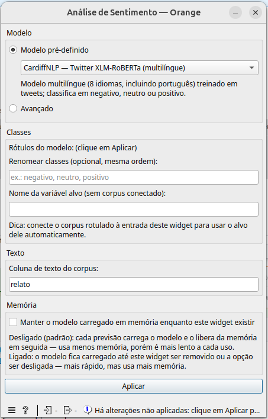
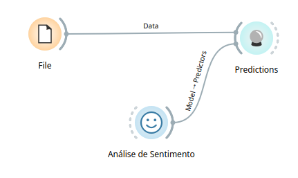
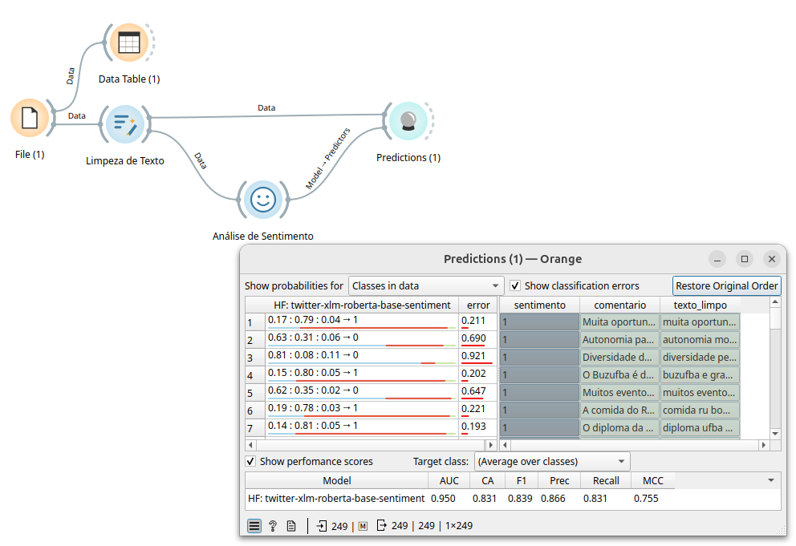

# Widget: Análise de Sentimento

Carrega um modelo de classificação de texto do Hugging Face (ex.: análise
de sentimento) e o transforma em um modelo do Orange, compatível com os
widgets nativos **Predictions**, **Save Model** e **Load Model**.



## Entradas e saídas

- **Entrada — Data** (opcional): um corpus/tabela rotulado(a). Se
  conectado, o widget usa a variável-alvo do corpus automaticamente (ver
  seção "Classes"), o que permite ao **Predictions** calcular as métricas
  de avaliação (AUC, CA, F1 etc.).
- **Saída — Model**: o modelo pronto, para ligar na entrada
  **Model - Predictors** do widget **Predictions** (ou em **Save Model**,
  para salvar em `.pkcls`).

Diferente dos outros widgets deste add-on, este não processa dados
diretamente — ele só monta o modelo. Quem roda a classificação é o
widget nativo **Predictions**, de posse dos dados reais a classificar.

## Fluxo base



```
File ──────────────────────────► Predictions
Análise de Sentimento ─ Model ──►
```

- **File**: carrega os dados a classificar (precisam ter uma coluna de
  texto com o mesmo nome configurado em "Coluna de texto do corpus").
- **Análise de Sentimento**: monta o modelo a partir do Hugging Face.
- **Predictions**: recebe os dados em **Data** e o modelo em
  **Model - Predictors**, e mostra a classe prevista e as probabilidades
  de cada classe para cada linha.

## Fluxo completo (com limpeza de texto e avaliação)



```
File ─┬─► Data Table
      └─► Limpeza de Texto ──────────────────► Predictions
Análise de Sentimento ───────────── Model ───►
```

Quando o **File** de entrada já tem uma coluna-alvo rotulada (ex.:
`sentimento`, com os valores reais de cada comentário), o **Predictions**
passa a mostrar também as **métricas de desempenho** (AUC, CA, F1,
Prec, Recall, MCC), comparando a classe prevista com o rótulo real —
útil para avaliar a qualidade do modelo escolhido antes de usá-lo em
dados sem rótulo. O widget **Limpeza de Texto** antes do Predictions é
opcional, mas melhora a entrada do modelo (ver a documentação desse
widget).

## Campos do widget

### Modelo

- **Modelo pré-definido**: lista de modelos já testados (veja a tabela
  abaixo).
- **Avançado**: permite informar qualquer modelo de classificação de
  texto do Hugging Face. Veja os critérios na seção abaixo.

#### Modelos pré-carregados

| Modelo | Identificador no Hugging Face | Classes | Quando usar |
|---|---|---|---|
| **CardiffNLP — Twitter XLM-RoBERTa** | `cardiffnlp/twitter-xlm-roberta-base-sentiment` | negativo, neutro, positivo | Modelo multilíngue (8 idiomas, incluindo português) treinado em tweets — boa opção padrão para redes sociais e textos curtos e informais. |
| **NLPTown — BERT multilíngue** | `nlptown/bert-base-multilingual-uncased-sentiment` | 1 a 5 estrelas | Modelo multilíngue (inglês, holandês, alemão, francês, italiano e espanhol) treinado em avaliações de produtos — quando se quer uma escala de 1 a 5 em vez de negativo/neutro/positivo. |
| **pysentimiento — BERTweet em português** | `pysentimiento/bertweet-pt-sentiment` | positivo, neutro, negativo | Modelo treinado especificamente em português (tweets) — quando os textos são majoritariamente em português e se quer evitar um modelo multilíngue genérico. |

Esses modelos são baixados do Hugging Face Hub no primeiro uso (ficam em
cache em `~/.cache/huggingface`).

### Classes

- **Rótulos do modelo**: mostra os rótulos originais do modelo
  (`id2label` do próprio Hugging Face) depois de clicar em **Aplicar**;
  é só informativo.
- **Renomear classes (opcional, mesma ordem)**: lista separada por
  vírgulas para trocar os nomes dos rótulos originais por nomes mais
  claros (ex.: trocar `LABEL_0, LABEL_1, LABEL_2` por
  `negativo, neutro, positivo`). Se preenchido, precisa ter exatamente o
  mesmo número de nomes que os rótulos do modelo, na mesma ordem, e os
  nomes não podem se repetir.
- **Nome da variável alvo (sem corpus conectado)**: nome dado à variável
  de classe de saída quando não há corpus conectado à entrada **Data**.
  Esse campo é ignorado (e desabilitado) quando há um corpus conectado —
  nesse caso, o widget usa a variável-alvo do próprio corpus, para que o
  Orange reconheça que modelo e corpus falam da mesma classe e o
  **Predictions** calcule as métricas de avaliação automaticamente.

### Texto

- **Coluna de texto do corpus**: nome da coluna de texto que o modelo vai
  ler quando o **Predictions** o executar sobre os dados. Precisa bater
  com o nome exato de uma coluna de texto da tabela ligada ao
  **Predictions** (não necessariamente da tabela ligada a este widget).

### Memória

- **Manter o modelo carregado em memória enquanto este widget existir**:
  desligado (padrão), cada previsão (cada vez que o **Predictions** roda)
  carrega o modelo e o libera da memória em seguida — usa menos memória,
  porém é mais lento a cada uso. Ligado, o modelo fica carregado até o
  widget ser removido ou a opção ser desligada — mais rápido em
  previsões repetidas, mas usa mais memória o tempo todo.

### Aplicar

Depois de ajustar qualquer opção, é preciso clicar em **Aplicar** para
(re)carregar o modelo e atualizar a saída — um aviso "Há alterações não
aplicadas: clique em Aplicar..." aparece enquanto isso. Ao clicar, o
widget baixa a configuração e o tokenizador do modelo, baixa os pesos e
roda uma inferência de teste antes de liberar a saída, reportando o
progresso de cada etapa.

## Critérios para adicionar um modelo no modo "Avançado"

No modo avançado, quatro campos ficam disponíveis:

1. **Nome no Hugging Face** (obrigatório): o identificador do modelo no
   Hub, no formato `organizacao/nome-do-modelo`. Para funcionar, o
   modelo precisa:
   - Ser um **classificador de sequência** (`*ForSequenceClassification`,
     carregável pelo pipeline `text-classification` do `transformers`) —
     o widget avisa se a arquitetura do `config.json` não contém
     `SequenceClassification`, pois o resultado pode não fazer sentido.
   - Ter **pelo menos duas classes** definidas em `id2label` no
     `config.json` do modelo — sem isso, o widget rejeita o modelo por
     "não parecer um classificador".
   - Ser capaz de rodar **localmente** (CPU ou GPU) — o widget baixa
     config, tokenizador e pesos do Hugging Face Hub; modelos que só
     funcionam via API paga/remota não são suportados.

2. **Tokenizador (opcional; vazio = o do modelo)**: por padrão, o
   tokenizador é baixado do mesmo repositório do modelo. Preencha este
   campo para usar o tokenizador de outro repositório — por exemplo,
   quando o modelo escolhido não publica um `tokenizer.json` compatível
   e é preciso apontar para um equivalente (ex.:
   `FacebookAI/xlm-roberta-base` para modelos baseados em XLM-RoBERTa).

3. **Carregamento (from_pretrained / pipeline)** (opcional): um objeto
   JSON com argumentos extras repassados ao carregar o config, o
   tokenizador e o pipeline (ex.: `{"revision": "main", "device": 0}`).
   Útil para fixar uma revisão/branch, forçar um dispositivo
   (`"device": 0` para a primeira GPU, `"device": "cpu"` para forçar
   CPU) ou modelos que exigem `"trust_remote_code": true`.

4. **Inferência (chamada do pipeline)** (opcional): um objeto JSON com
   argumentos extras repassados a cada chamada do pipeline (ex.:
   `{"max_length": 128, "batch_size": 8}`). O parâmetro `top_k` é
   ignorado mesmo se informado (um aviso é mostrado) — o add-on sempre
   pede todas as classes do pipeline, pois precisa das probabilidades
   de todas elas para alimentar o **Predictions**.

Em ambos os campos de JSON, qualquer texto inválido (que não seja um
objeto `{ }` bem formado) gera uma mensagem de erro indicando onde está o
problema, e o modelo não é aplicado até o JSON ser corrigido.
