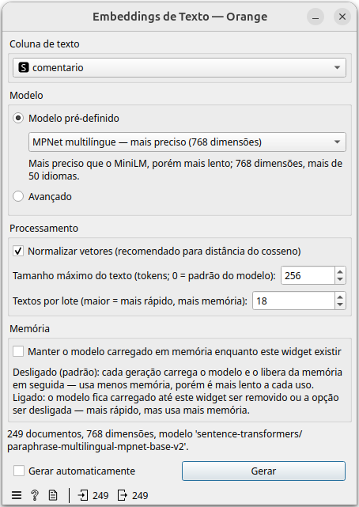
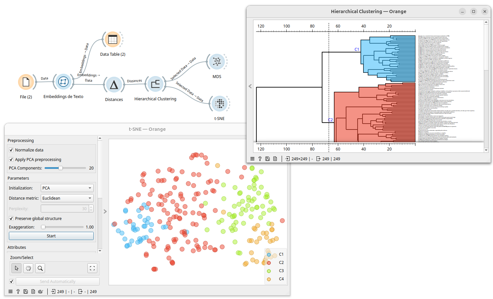

# Widget: Embeddings de Texto

Gera embeddings de sentença com um modelo do Hugging Face, prontos para
uso com o widget nativo **Distances** (ex.: para clusterização, mapas de
similaridade, projeções como t-SNE/MDS).



## Entradas e saídas

- **Entrada — Data**: uma tabela com ao menos uma coluna de texto (meta).
- **Saída — Embeddings**: a tabela original, com os embeddings de cada
  documento como novos atributos contínuos (`Dim1`, `Dim2`, ...) — os
  atributos originais são substituídos por eles, mas classes e metas são
  preservadas. Essa saída já pode ser ligada direto a **Distances**.

## Fluxo base



```
File ─┬─► Data Table
      └─► Embeddings de Texto → Distances → Hierarchical Clustering ─┬─► MDS
                                                                      └─► t-SNE
```

- **File**: carrega os dados de entrada (ex.: uma tabela com uma coluna
  de comentários).
- **Embeddings de Texto**: gera um vetor numérico por documento,
  representando o significado do texto.
- **Distances**: calcula a distância (ex.: cosseno) entre cada par de
  vetores de embedding.
- **Hierarchical Clustering**: agrupa os documentos por similaridade a
  partir das distâncias, e permite cortar o dendrograma em clusters
  (`C1`, `C2`, ... na captura de tela).
- **MDS** / **t-SNE**: projetam os embeddings em 2D para visualização,
  colorindo os pontos pelo cluster encontrado no Hierarchical Clustering
  (a seleção de clusters — `Selected Data → Data` — alimenta ambos).

Este widget resolve apenas a geração dos vetores; qualquer combinação de
widgets nativos do Orange que trabalhe com **Distances** (clusterização,
projeções, outliers etc.) pode ser usada depois dele.

## Campos do widget

### Coluna de texto

Escolhe qual coluna de texto (meta) da entrada será usada para gerar os
embeddings.

### Modelo

- **Modelo pré-definido**: lista de modelos multilíngues já testados
  (veja a tabela abaixo).
- **Avançado**: permite informar qualquer modelo do Hugging Face
  compatível com `sentence-transformers`. Veja os critérios na seção
  abaixo.

#### Modelos pré-carregados

| Modelo | Identificador no Hugging Face | Dimensões | Quando usar |
|---|---|---|---|
| **MiniLM multilíngue — rápido** | `sentence-transformers/paraphrase-multilingual-MiniLM-L12-v2` | 384 | Modelo leve e rápido, bom equilíbrio entre qualidade e velocidade; mais de 50 idiomas. Boa primeira escolha, especialmente para bases grandes. |
| **MPNet multilíngue — mais preciso** | `sentence-transformers/paraphrase-multilingual-mpnet-base-v2` | 768 | Mais preciso que o MiniLM, porém mais lento; mais de 50 idiomas. Quando a qualidade da separação entre textos importa mais que a velocidade. |
| **LaBSE (109 idiomas)** | `sentence-transformers/LaBSE` | 768 | Modelo do Google voltado para comparar frases entre idiomas diferentes (ex.: encontrar textos equivalentes em português e inglês); cobre 109 idiomas. |
| **Qwen3 Embedding 0.6B — maior qualidade** | `Qwen/Qwen3-Embedding-0.6B` | 1024 | Modelo grande baseado em LLM; maior qualidade de embedding, porém bem mais pesado e lento para baixar e processar — reservar para bases menores ou quando a qualidade é prioridade sobre o tempo. |

Esses modelos são baixados do Hugging Face Hub no primeiro uso (ficam em
cache em `~/.cache/huggingface`) e carregam localmente (CPU ou GPU) a
cada geração — ou ficam carregados entre gerações, se a opção **Manter o
modelo carregado em memória** estiver ligada (ver seção "Memória"
abaixo).

### Processamento

- **Normalizar vetores (recomendado para distância do cosseno)**: ajusta
  cada embedding para ter norma 1. Mantenha ligado quando for usar o
  **Distances** com a métrica cosseno (o padrão mais comum para texto);
  desligue apenas se for usar uma métrica ou um pós-processamento que
  exija os vetores "crus".
- **Tamanho máximo do texto (tokens; 0 = padrão do modelo)**: trunca o
  texto de entrada em até N tokens antes de gerar o embedding. `0` usa o
  limite padrão do próprio modelo.
- **Textos por lote (maior = mais rápido, mais memória)**: quantos
  textos são processados de uma vez pelo modelo. Valores maiores
  aceleram a geração, mas usam mais memória (RAM ou VRAM da GPU).

### Memória

- **Manter o modelo carregado em memória enquanto este widget existir**:
  desligado (padrão), cada geração carrega o modelo e o libera da
  memória em seguida — usa menos memória, porém é mais lento a cada uso.
  Ligado, o modelo fica carregado até o widget ser removido ou a opção
  ser desligada — mais rápido em gerações repetidas, mas usa mais
  memória o tempo todo.

### Gerar automaticamente / Gerar

Se **Gerar automaticamente** estiver marcado, qualquer mudança nas
opções acima dispara uma nova geração sozinha. Caso contrário, é preciso
clicar em **Gerar** depois de ajustar as opções (um aviso "Configurações
alteradas: clique em Gerar" aparece enquanto isso).

## Critérios para adicionar um modelo no modo "Avançado"

No modo avançado, três campos ficam disponíveis:

1. **Nome no Hugging Face** (obrigatório): o identificador do modelo no
   Hub, no formato `organizacao/nome-do-modelo`
   (ex.: `sentence-transformers/all-MiniLM-L6-v2`). Para funcionar, o
   modelo precisa:
   - Ser **compatível com a biblioteca `sentence-transformers`**, ou
     seja, ter no repositório os arquivos de configuração que descrevem
     como gerar o embedding da sentença (pooling, normalização etc. —
     normalmente um `modules.json`/`config_sentence_transformers.json`).
     Isso vale tanto para modelos publicados nativamente nesse formato
     quanto para modelos de embedding mais recentes que o
     `sentence-transformers` já sabe carregar.
   - Ser capaz de rodar **localmente** (CPU ou GPU) — o widget baixa os
     pesos do Hugging Face Hub e os carrega com
     `SentenceTransformer(nome_modelo, ...)`; modelos que só funcionam
     via API paga/remota não são suportados.
   - De preferência, **suportar o(s) idioma(s) dos seus textos**
     (multilíngue ou específico do idioma).
   - Se o modelo for privado/gated no Hub, é necessário já estar
     autenticado no Hugging Face no ambiente onde o Orange roda (ex.:
     `huggingface-cli login`), já que o widget não tem campo de token.

2. **Carregamento (SentenceTransformer)** (opcional): um objeto JSON com
   argumentos extras repassados direto ao construtor
   `SentenceTransformer(nome_modelo, **kwargs)`. Útil para, por exemplo:
   - `{"trust_remote_code": true}` — modelos que definem código Python
     próprio no repositório do Hub.
   - `{"revision": "main"}` — fixar uma revisão/branch/tag específica.
   - `{"device": "cuda"}` — forçar um dispositivo (por padrão o widget já
     tenta usar a GPU automaticamente e cai para CPU se falhar).

3. **Inferência (encode)** (opcional): um objeto JSON com argumentos
   extras repassados a cada chamada de `modelo.encode(...)` (ex.:
   `{"prompt_name": "query"}`). Útil para modelos que diferenciam o
   embedding de consultas (query) do embedding de documentos (ex.:
   alguns modelos recomendados para busca semântica/RAG).

Em ambos os campos de JSON, qualquer texto inválido (que não seja um
objeto `{ }` bem formado) gera uma mensagem de erro indicando onde está o
problema, e a geração não é executada até o JSON ser corrigido.
