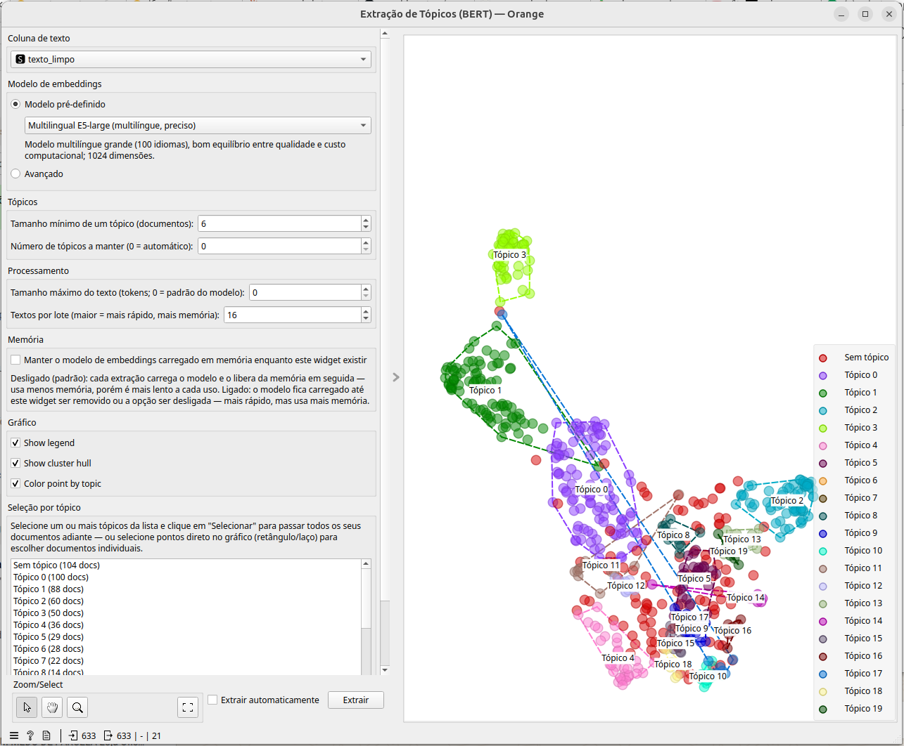

# Widget: Extração de Tópicos (BERT)

Descobre tópicos automaticamente a partir de embeddings de sentença do
Hugging Face, agrupados com o [BERTopic](https://maartengr.github.io/BERTopic/)
(UMAP + HDBSCAN) — não é preciso definir os tópicos antecipadamente.

## Entradas e saídas

- **Entrada — Data**: uma tabela com ao menos uma coluna de texto (meta).
- **Saída — Data**: a tabela original com os embeddings de cada documento
  como atributos contínuos (`Dim1`, `Dim2`, ...) e duas metas novas —
  `Tópico` (discreta) e `Tópico (confiança)`.
- **Saída — Selected Data**: somente os documentos selecionados no gráfico
  ou na lista de tópicos.
- **Saída — Topics**: uma linha por tópico, com a quantidade de documentos e
  as palavras-chave que o descrevem.

## Campos do widget

### Coluna de texto

Escolhe qual coluna de texto (meta) da entrada será usada para gerar os
embeddings e extrair os tópicos.

### Modelo de embeddings

- **Modelo pré-definido**: lista de modelos multilíngues já testados,
  prontos para uso sem nenhuma configuração extra (veja a tabela abaixo).
- **Avançado**: permite informar qualquer modelo do Hugging Face
  compatível com `sentence-transformers`. Veja os critérios na seção
  abaixo.

#### Modelos pré-carregados

| Modelo | Identificador no Hugging Face | Quando usar |
|---|---|---|
| **MiniLM multilíngue — rápido (recomendado)** | `sentence-transformers/paraphrase-multilingual-MiniLM-L12-v2` | Opção padrão: modelo leve e rápido (384 dimensões), com bom equilíbrio entre qualidade e velocidade; cobre mais de 50 idiomas. Boa primeira escolha para a maioria dos casos e para bases de documentos grandes, onde velocidade importa. |
| **BGE-M3 (multilíngue, maior qualidade)** | `BAAI/bge-m3` | Modelo multilíngue de alta qualidade (mais de 100 idiomas), com suporte a textos longos (até 8192 tokens). Gera embeddings de 1024 dimensões; é mais pesado e lento que o MiniLM, mas tende a separar melhor os tópicos quando os textos são longos ou a precisão é mais importante que a velocidade. |
| **Multilingual E5-large (multilíngue, preciso)** | `intfloat/multilingual-e5-large` | Modelo multilíngue grande (100 idiomas, 1024 dimensões), com bom equilíbrio entre qualidade e custo computacional — uma alternativa ao BGE-M3 quando se quer mais precisão que o MiniLM sem pagar o custo de textos longos do BGE-M3. |

Esses três modelos já vêm com os parâmetros de carregamento testados e
não exigem nenhum JSON adicional. Eles são baixados do Hugging Face Hub
no primeiro uso (ficam em cache em `~/.cache/huggingface`) e, a partir
daí, carregam localmente (CPU ou GPU) a cada extração — ou ficam
carregados na memória entre extrações, se a opção **Manter o modelo de
embeddings carregado em memória** estiver ligada (ver seção "Memória"
abaixo).

### Tópicos

- **Tamanho mínimo de um tópico (documentos)**: número mínimo de
  documentos para que um agrupamento vire um tópico (parâmetro
  `min_topic_size` do BERTopic). Valores menores geram mais tópicos,
  porém menores e mais ruidosos.
- **Número de tópicos a manter (0 = automático)**: se maior que 0, reduz
  o número de tópicos ao valor informado, mesclando os mais parecidos
  (parâmetro `nr_topics` do BERTopic). `0` deixa o BERTopic decidir
  sozinho a quantidade de tópicos.

### Processamento

- **Tamanho máximo do texto (tokens; 0 = padrão do modelo)**: trunca o
  texto de entrada em até N tokens antes de gerar o embedding. `0` usa o
  limite padrão do próprio modelo.
- **Textos por lote**: quantos textos são processados de uma vez pelo
  modelo de embeddings. Valores maiores aceleram a extração, mas usam
  mais memória (RAM ou VRAM da GPU).

### Memória

- **Manter o modelo de embeddings carregado em memória enquanto este
  widget existir**: desligado (padrão), cada extração carrega o modelo e
  o libera da memória em seguida — usa menos memória, porém é mais lento
  a cada uso. Ligado, o modelo fica carregado até o widget ser removido
  ou a opção ser desligada — mais rápido em extrações repetidas, mas usa
  mais memória o tempo todo.

### Gráfico

- **Show legend**: mostra/esconde a legenda de cores dos tópicos.
- **Show cluster hull**: desenha o contorno (envoltória convexa) de cada
  tópico no gráfico de dispersão.
- **Color point by topic**: colore cada ponto conforme o tópico atribuído
  a ele.

### Seleção por tópico

Lista com um item por tópico (incluindo "Sem tópico", os documentos que o
BERTopic não conseguiu agrupar) e a respectiva quantidade de documentos.
Selecione um ou mais tópicos e clique em **Selecionar** para enviar todos
os seus documentos à saída *Selected Data* — ou selecione pontos
diretamente no gráfico (retângulo ou laço) para escolher documentos
individuais. **Limpar seleção** desmarca tudo.

### Extrair automaticamente / Extrair

Se **Extrair automaticamente** estiver marcado, qualquer mudança nas
opções acima dispara uma nova extração sozinha. Caso contrário, é preciso
clicar em **Extrair** depois de ajustar as opções (um aviso "Configurações
alteradas: clique em Extrair" aparece enquanto isso).

## Critérios para adicionar um modelo no modo "Avançado"

No modo avançado, três campos ficam disponíveis:

1. **Nome no Hugging Face** (obrigatório): o identificador do modelo no
   Hub, no formato `organizacao/nome-do-modelo`
   (ex.: `sentence-transformers/all-MiniLM-L6-v2`). Para que o modelo
   funcione, ele precisa:
   - Ser **compatível com a biblioteca `sentence-transformers`**, ou
     seja, ter no repositório os arquivos de configuração que descrevem
     como gerar o embedding da sentença (pooling, normalização etc. —
     normalmente um `modules.json`/`config_sentence_transformers.json`).
     Isso vale tanto para modelos publicados nativamente nesse formato
     quanto para modelos de embedding mais recentes que o
     `sentence-transformers` já sabe carregar.
   - Ser capaz de rodar **localmente** (CPU ou GPU) — o widget baixa os
     pesos do Hugging Face Hub e os carrega com
     `SentenceTransformer(nome_modelo, ...)`; modelos que só funcionam
     via API paga/remota não são suportados.
   - De preferência, **suportar o(s) idioma(s) dos seus textos**
     (multilíngue ou específico do idioma).
   - Se o modelo for privado/gated no Hub, é necessário já estar
     autenticado no Hugging Face no ambiente onde o Orange roda (ex.:
     `huggingface-cli login`), já que o widget não tem campo de token.

2. **Carregamento (SentenceTransformer)** (opcional): um objeto JSON com
   argumentos extras repassados direto ao construtor
   `SentenceTransformer(nome_modelo, **kwargs)`. Útil para, por exemplo:
   - `{"trust_remote_code": true}` — modelos que definem código Python
     próprio no repositório do Hub.
   - `{"revision": "main"}` — fixar uma revisão/branch/tag específica.
   - `{"device": "cuda"}` — forçar um dispositivo (por padrão o widget já
     tenta usar a GPU automaticamente e cai para CPU se falhar).

3. **Parâmetros do BERTopic** (opcional): um objeto JSON com argumentos
   extras repassados direto ao construtor `BERTopic(**kwargs)`
   (ex.: `{"top_n_words": 15}`). Regras importantes:
   - **Não inclua `embedding_model`** — o widget já define esse parâmetro
     internamente com o modelo de embeddings escolhido acima.
   - **Evite repetir `min_topic_size` e `nr_topics`** aqui — esses dois já
     têm campos dedicados na seção "Tópicos" do widget. Se mesmo assim
     forem incluídos neste JSON, o valor do JSON prevalece para
     `min_topic_size`, enquanto o valor do campo "Número de tópicos a
     manter" (quando diferente de `0`) prevalece sobre o `nr_topics` do
     JSON — para evitar essa ambiguidade, prefira sempre os campos
     dedicados.

Em ambos os campos de JSON, qualquer texto inválido (que não seja um
objeto `{ }` bem formado) gera uma mensagem de erro indicando onde está o
problema, e a extração não é executada até o JSON ser corrigido.
