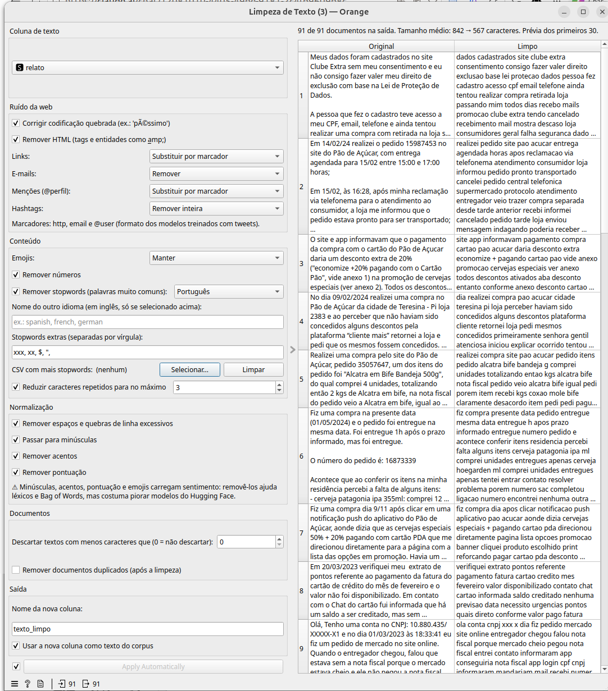

# Widget: Limpeza de Texto

Limpa o texto (HTML, links, menções, emojis, acentos...) e cria uma nova
coluna com o resultado, mostrando uma prévia antes/depois dos primeiros
documentos.

> Este widget é específico para os modelos deste add-on (Text Analysis) —
> os modelos do Hugging Face (Análise de Sentimento, Tradução, Extração
> de Tópicos, Embeddings de Texto, Zero-shot Classification) leem o
> **texto corrido** de cada documento (uma string). Por isso, a limpeza
> aqui trabalha e produz **texto corrido**: cada opção aplica uma
> transformação (ex.: regex, substituição) sobre a string inteira do
> documento, e o resultado é outra string pronta para ir direto a um
> desses modelos.
>
> Já o widget **Preprocess Text** do add-on Orange3-Text (Text Mining)
> funciona de outra forma: ele faz um pré-processamento **palavra a
> palavra** (tokenização, normalização/stemming/lematização, filtragem
> de tokens etc.), produzindo um corpus com a lista de tokens de cada
> documento, no formato que os widgets clássicos de PLN do Orange3-Text
> esperam (Bag of Words, Word Cloud, Topic Modelling tradicional, etc.).
> Esse formato tokenizado não é o que os modelos do Hugging Face deste
> add-on esperam como entrada — eles devem continuar recebendo texto
> corrido (ou seja, não usar o "Preprocess Text" do Text Mining antes de
> um widget deste add-on).

## Entradas e saídas

- **Entrada — Data**: uma tabela com ao menos uma coluna de texto (meta).
- **Saída — Data**: a tabela original com uma nova coluna de texto
  (ou, conforme necessário, com documentos descartados — ver "Documentos"
  abaixo).

Todas as limpezas são aplicadas numa ordem fixa (pensada para evitar
conflitos — ex.: e-mails são tratados antes de menções, pontuação depois
dos marcadores), independente da ordem em que as seções aparecem na
tela.

## Campos do widget

### Coluna de texto

Escolhe qual coluna de texto (meta) da entrada será limpa.

### Ruído da web

- **Corrigir codificação quebrada (ex.: 'péssimo')**: corrige texto que
  foi decodificado com a codificação errada (ex.: UTF-8 lido como
  Latin-1), usando a biblioteca `ftfy`. Se a biblioteca não estiver
  instalada, um aviso é mostrado e a opção não tem efeito.
- **Remover HTML (tags e entidades como &)**: remove tags HTML
  (`<b>`, ` ` etc.) e decodifica entidades HTML (`&amp;` → `&`).
- **Links**: Manter, Remover, ou Substituir por marcador (`http`) — o
  marcador é o mesmo formato usado pelos modelos do Hugging Face
  treinados com tweets.
- **E-mails**: Manter, Remover, ou Substituir por marcador (`email`).
- **Menções (@perfil)**: Manter, Remover, ou Substituir por marcador
  (`@user`).
- **Hashtags**: Manter, Remover só o `#` (mantém a palavra, ex.:
  `#promoção` → `promoção`), ou Remover inteira (ex.: `#promoção` →
  removida).

### Conteúdo

- **Emojis**: Manter, Remover, ou Converter em texto (ex.: 😀 → "rosto
  sorrindo"). A conversão em texto depende da biblioteca `emoji`; sem
  ela, um aviso é mostrado e os emojis só são removidos.
- **Remover números**: remove sequências numéricas (inclusive com ponto
  ou vírgula decimal, ex.: `1.234,56`).
- **Remover stopwords (palavras muito comuns)**: remove palavras de
  baixo valor semântico (ex.: "de", "a", "que"). O idioma é escolhido ao
  lado:
  - **Português** / **English**: usam uma lista embutida no add-on (não
    precisam de download).
  - **Outro idioma (baixa via NLTK)**: baixa a lista do idioma informado
    no campo **Nome do outro idioma** (em inglês, ex.: `spanish`,
    `french`, `german`) via NLTK, na primeira vez que for usado — requer
    a biblioteca `nltk` instalada e conexão com a internet.
- **Stopwords extras (separadas por vírgula)**: palavras adicionais a
  remover, além da lista do idioma (ex.: gírias ou termos específicos do
  domínio: `tipo, né, então`).
- **CSV com mais stopwords**: carrega uma lista extra de palavras a
  partir de um arquivo CSV (qualquer célula com texto vira uma
  stopword). Os botões **Selecionar...** e **Limpar** escolhem ou
  removem o arquivo.
- **Reduzir caracteres repetidos para no máximo N**: reduz letras e
  pontuação repetidas em excesso (ex.: `"muuuuito!!!!!!"` → `"muuuito!!!"`
  com N=3). Dígitos não são afetados (não altera números como `1000`).

### Normalização

- **Remover espaços e quebras de linha excessivos**: colapsa espaços,
  tabulações e quebras de linha seguidos em um único espaço, e remove
  espaços nas pontas do texto.
- **Passar para minúsculas**: converte todo o texto para minúsculas.
- **Remover acentos**: remove acentuação (ex.: `"ótimo"` → `"otimo"`).
- **Remover pontuação**: substitui todo sinal de pontuação por espaço.

> ⚠ Minúsculas, acentos, pontuação e emojis carregam sentimento:
> removê-los ajuda léxicos e Bag of Words, mas costuma **piorar** modelos
> do Hugging Face (ex.: Análise de Sentimento, Zero-shot Classification,
> Tradução) — eles já lidam bem com texto "cru" e usam essas pistas para
> entender o tom do texto. Avalie manter essas quatro opções desligadas
> quando o texto limpo for usado como entrada de um modelo do Hugging
> Face, e ligá-las apenas para técnicas clássicas (TF-IDF, Bag of Words,
> léxicos de sentimento).

### Documentos

- **Descartar textos com menos caracteres que (0 = não descartar)**:
  remove da saída qualquer documento cujo texto limpo (não o original)
  fique com menos caracteres que o valor informado. `0` não descarta
  nada.
- **Remover documentos duplicados (após a limpeza)**: remove da saída
  documentos cujo texto limpo seja idêntico a um já visto antes (mantém
  a primeira ocorrência).

### Saída

- **Nome da nova coluna**: nome da coluna criada com o texto limpo (o
  padrão é `texto_limpo`; se já existir uma coluna com esse nome, um
  sufixo é acrescentado e um aviso é mostrado).
- **Usar a nova coluna como texto do corpus**: marca a nova coluna como o
  texto principal do corpus (equivalente ao "text feature" do
  Orange3-Text), para que os próximos widgets (ex.: Análise de
  Sentimento, Extração de Tópicos, Embeddings de Texto) já usem o texto
  limpo por padrão.

### Apply Automatically

Como nos widgets nativos do Orange, se marcado (padrão), qualquer mudança
nas opções acima é aplicada sozinha. Desmarcado, é preciso clicar em
**Apply** depois de ajustar as opções.

### Prévia

O painel principal mostra uma tabela com o texto original e o texto
limpo lado a lado, para os primeiros 30 documentos, além de um resumo
(quantos documentos ficaram na saída, quantos foram descartados, e o
tamanho médio do texto antes → depois da limpeza).
