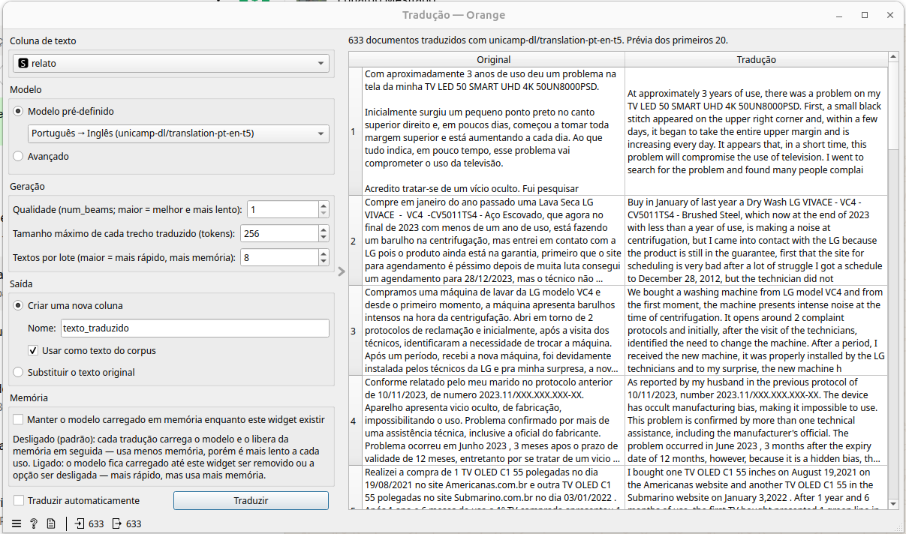
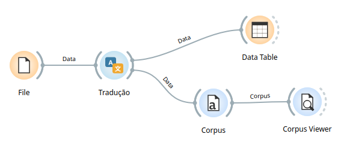

# Widget: Tradução

Traduz textos com modelos de tradução do Hugging Face (seq2seq), de forma
automática ou mediante clique, rodando em segundo plano com barra de
progresso e usando a GPU, se houver.



## Entradas e saídas

- **Entrada — Data**: uma tabela com ao menos uma coluna de texto (meta).
- **Saída — Data**: a tabela original, com o texto traduzido em uma nova
  coluna ou substituindo a coluna original (conforme a opção escolhida em
  "Saída").

## Fluxo base



```
File → Tradução ─┬─► Data Table
                 └─► Corpus → Corpus Viewer
```

- **File**: carrega os dados de entrada (ex.: uma planilha com relatos em
  texto).
- **Tradução**: traduz a coluna de texto escolhida, de acordo com as
  opções descritas abaixo.
- **Data Table**: inspeciona a tabela de saída já com a tradução (nova
  coluna ou coluna substituída).
- **Corpus**: converte a saída em um corpus do Orange3-Text, usando a
  coluna traduzida como texto (automático se "Usar como texto do
  corpus" estiver marcado).
- **Corpus Viewer**: visualiza os documentos do corpus traduzido, um a
  um.

## Campos do widget

### Coluna de texto

Escolhe qual coluna de texto (meta) da entrada será traduzida.

### Modelo

- **Modelo pré-definido**: lista de modelos já testados (veja a tabela
  abaixo).
- **Avançado**: permite informar qualquer modelo de tradução do Hugging
  Face. Veja os critérios na seção abaixo.

#### Modelos pré-carregados

| Modelo | Identificador no Hugging Face | Quando usar |
|---|---|---|
| **Português → Inglês** | `unicamp-dl/translation-pt-en-t5` | Traduzir textos em português para inglês — por exemplo, antes de usar um modelo de classificação/sentimento que só existe em inglês. |
| **Inglês → Português** | `unicamp-dl/translation-en-pt-t5` | Traduzir textos em inglês para português. |
| **Multilíngue, 100 idiomas** | `facebook/m2m100_418M` | Traduzir entre qualquer par dos 100 idiomas suportados (ver seção "Idiomas"); mais flexível, porém mais pesado que os modelos T5 acima. |

Esses modelos são baixados do Hugging Face Hub no primeiro uso (ficam em
cache em `~/.cache/huggingface`) e carregam localmente (CPU ou GPU) a
cada tradução — ou ficam carregados entre traduções, se a opção
**Manter o modelo carregado em memória** estiver ligada (ver seção
"Memória" abaixo).

### Idiomas

Só aparece quando o modelo selecionado é do tipo **M2M100** (o
pré-definido multilíngue, ou um avançado desse tipo). Escolhe o idioma de
origem ("De:") e de destino ("Para:") entre os 100 suportados pelo
modelo. Um erro é mostrado se os dois idiomas forem iguais.

### Geração

- **Qualidade (num_beams; maior = melhor e mais lento)**: número de
  sequências exploradas em paralelo pelo *beam search* do modelo durante
  a geração da tradução. `1` é o mais rápido (greedy); valores maiores
  tendem a gerar traduções um pouco melhores, a um custo de velocidade
  maior.
- **Tamanho máximo de cada trecho traduzido (tokens)**: limite de tokens
  gerados para cada trecho de texto. Textos longos já são divididos em
  frases antes da tradução (ver observação abaixo), mas se um trecho
  individual gerar uma tradução mais longa que esse limite, ela é
  cortada.
- **Textos por lote (maior = mais rápido, mais memória)**: quantos
  trechos são traduzidos de uma vez. Valores maiores aceleram a
  tradução, mas usam mais memória (RAM ou VRAM da GPU).

> Textos longos (mais de ~400 caracteres) são divididos automaticamente
> em frases inteiras antes de serem enviados ao modelo, pois os modelos
> de tradução só leem cerca de 512 tokens de uma vez — sem essa divisão,
> o final de textos longos seria simplesmente cortado da tradução.

### Saída

- **Criar uma nova coluna**: adiciona a tradução em uma coluna nova.
  - **Nome**: nome da nova coluna (o padrão é `texto_traduzido`; se já
    existir uma coluna com esse nome, um sufixo é acrescentado e um
    aviso é mostrado).
  - **Usar como texto do corpus**: marca a nova coluna como o texto
    principal do corpus (equivalente ao "text feature" do Orange3-Text),
    para que os próximos widgets (ex.: Modelo Hugging Face) já usem a
    tradução por padrão.
- **Substituir o texto original**: sobrescreve o conteúdo da própria
  coluna escolhida em "Coluna de texto" com a tradução.

### Memória

- **Manter o modelo carregado em memória enquanto este widget existir**:
  desligado (padrão), cada tradução carrega o modelo e o libera da
  memória em seguida — usa menos memória, porém é mais lento a cada uso.
  Ligado, o modelo fica carregado até o widget ser removido ou a opção
  ser desligada — mais rápido em traduções repetidas, mas usa mais
  memória o tempo todo.

### Traduzir automaticamente / Traduzir

Se **Traduzir automaticamente** estiver marcado, qualquer mudança nas
opções acima dispara uma nova tradução sozinha. Caso contrário, é preciso
clicar em **Traduzir** depois de ajustar as opções (um aviso
"Configurações alteradas: clique em Traduzir" aparece enquanto isso).

### Prévia

Abaixo do botão, o painel principal mostra uma tabela com o texto
original e a tradução lado a lado, para os primeiros 20 documentos.

## Critérios para adicionar um modelo no modo "Avançado"

No modo avançado, três campos ficam disponíveis:

1. **Nome no Hugging Face** (obrigatório): o identificador do modelo no
   Hub, no formato `organizacao/nome-do-modelo`. Para funcionar, o
   modelo precisa:
   - Ser um modelo **seq2seq** (texto-para-texto) carregável com
     `AutoModelForSeq2SeqLM.from_pretrained(...)` — a mesma classe usada
     pelos modelos pré-definidos. Modelos somente de codificação (ex.:
     BERT comum) ou decoder-only (a maioria dos LLMs de chat) não são
     suportados por este widget.
   - Ser capaz de rodar **localmente** (CPU ou GPU) — o widget baixa os
     pesos do Hugging Face Hub; modelos que só funcionam via API
     paga/remota não são suportados.
   - Ter um tokenizador compatível, carregável normalmente via
     `AutoTokenizer`.

2. **Tipo de modelo**: define como o texto de entrada é preparado antes
   da geração — escolha o que combina com o modelo informado:
   - **T5 / texto-para-texto (usa um prefixo de instrução)**: para
     modelos da família T5 (como os dois modelos português↔inglês
     pré-definidos), que esperam um prefixo de instrução em texto antes
     da frase a traduzir (ex.: `"translate Portuguese to English: "`).
     Informe esse prefixo exatamente como o modelo espera — normalmente
     documentado na página do modelo no Hub.
   - **M2M100 (usa os idiomas selecionados abaixo)**: para modelos da
     família M2M100 (como o modelo multilíngue pré-definido), que
     recebem o idioma de origem e destino por código (não por prefixo em
     texto). Ao escolher esse tipo, a seção "Idiomas" aparece para
     selecionar o par de idiomas.

3. **Prefixo** (só para o tipo T5): o texto de instrução enviado antes de
   cada trecho a traduzir. É específico de cada modelo T5 — consulte a
   documentação do modelo no Hugging Face Hub para saber qual prefixo
   usar (ex.: modelos diferentes podem esperar
   `"translate Portuguese to English: "`,
   `"translate English to German: "` etc.).

Diferente do widget de Extração de Tópicos (BERT), este widget não tem
campos de JSON para parâmetros extras de carregamento — os argumentos de
geração (`num_beams`, tamanho máximo de tokens, tamanho do lote) já ficam
disponíveis diretamente na seção "Geração".
