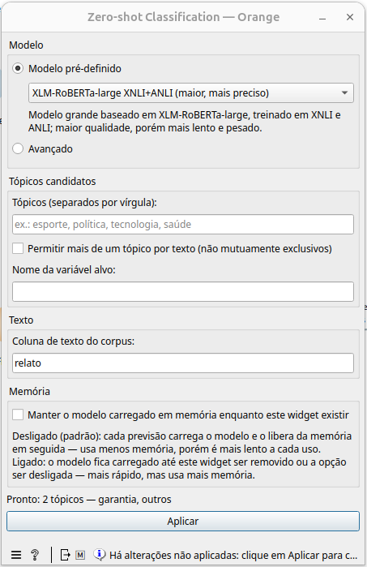
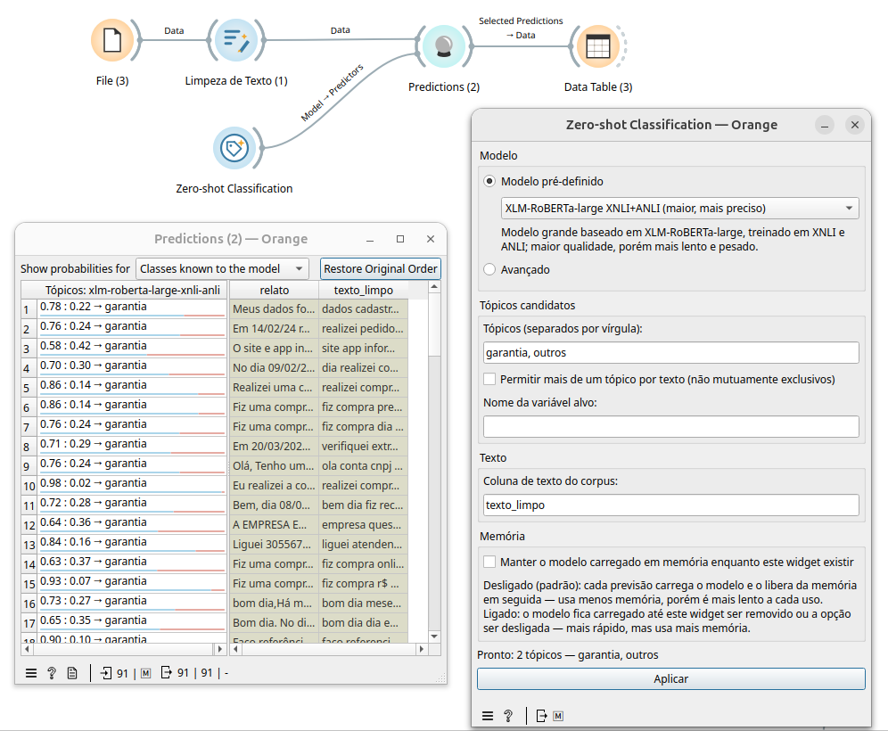

# Widget: Zero-shot Classification

Classifica textos por tópicos definidos pelo próprio usuário, usando um
modelo zero-shot multilíngue (NLI — *Natural Language Inference*) do
Hugging Face. Diferente da **Análise de Sentimento**, não precisa de
dados rotulados nem de um modelo já treinado para as classes desejadas —
basta listar os tópicos candidatos na hora.



## Entradas e saídas

- **Sem entrada de dados**: este widget não tem entrada — ele só monta
  o modelo, a partir das opções configuradas na própria tela.
- **Saída — Model**: o modelo pronto, para ligar na entrada
  **Model - Predictors** do widget **Predictions** (ou em **Save Model**,
  para salvar em `.pkcls`).

Quem roda a classificação é o widget nativo **Predictions**, de posse
dos dados reais a classificar — exatamente como no widget **Análise de
Sentimento**.

## Fluxo base



```
File ─► Limpeza de Texto ──────────────────► Predictions ──► Data Table
Zero-shot Classification ───────── Model ───►
```

- **File**: carrega os dados a classificar.
- **Limpeza de Texto** (opcional): normaliza o texto antes da
  classificação (ver a documentação desse widget).
- **Zero-shot Classification**: monta o modelo com os tópicos definidos
  pelo usuário.
- **Predictions**: recebe os dados em **Data** e o modelo em
  **Model - Predictors**, e mostra, para cada linha, a probabilidade de
  cada tópico e o tópico mais provável.
- **Data Table**: inspeciona a saída, incluindo a seleção feita no
  próprio Predictions (`Selected Predictions → Data`).

## Campos do widget

### Modelo

- **Modelo pré-definido**: lista de modelos zero-shot (NLI) multilíngues
  já testados (veja a tabela abaixo).
- **Avançado**: permite informar qualquer modelo zero-shot do Hugging
  Face. Veja os critérios na seção abaixo.

#### Modelos pré-carregados

| Modelo | Identificador no Hugging Face | Quando usar |
|---|---|---|
| **mDeBERTa-v3-base XNLI (recomendado)** | `MoritzLaurer/mDeBERTa-v3-base-xnli-multilingual-nli-2mil7` | Modelo multilíngue (mais de 100 idiomas) com bom equilíbrio entre qualidade e velocidade — boa primeira escolha para a maioria dos casos. |
| **MiniLMv2-L12 multilíngue (rápido, mais leve)** | `MoritzLaurer/multilingual-MiniLMv2-L12-mnli-xnli` | Modelo leve e rápido; quando velocidade importa mais que precisão máxima (ex.: bases grandes). |
| **XLM-V-base MNLI/XNLI (vocabulário amplo)** | `MoritzLaurer/xlm-v-base-mnli-xnli` | Modelo com vocabulário bem maior que o do XLM-R; útil para idiomas com escrita menos comum. |
| **XLM-RoBERTa-large XNLI+ANLI (maior, mais preciso)** | `vicgalle/xlm-roberta-large-xnli-anli` | Modelo grande, treinado em XNLI e ANLI; maior qualidade, porém mais lento e pesado — reservar para quando a precisão é prioridade sobre o tempo. |

Esses modelos são baixados do Hugging Face Hub no primeiro uso (ficam em
cache em `~/.cache/huggingface`).

### Tópicos candidatos

- **Tópicos (separados por vírgula)**: a lista de classes que o modelo
  vai considerar para cada texto (ex.:
  `esporte, política, tecnologia, saúde`). É preciso informar **pelo
  menos dois** tópicos, e eles não podem se repetir — diferente da
  Análise de Sentimento, aqui as classes não vêm do modelo, são
  definidas livremente pelo usuário a cada uso.
- **Permitir mais de um tópico por texto (não mutuamente exclusivos)**:
  desligado (padrão), as probabilidades dos tópicos somam 100% (o texto
  pertence a exatamente um tópico). Ligado, cada tópico é avaliado de
  forma independente — útil quando um texto pode pertencer a mais de um
  tópico ao mesmo tempo (ex.: um texto sobre "esporte" e "saúde" juntos).
  Nesse modo, um aviso lembra que as probabilidades não somam 100%.
- **Nome da variável alvo**: nome dado à variável de classe de saída
  (ex.: `topico`). Diferente da Análise de Sentimento, este widget não
  tem entrada de corpus, então não há como herdar o alvo de um corpus
  rotulado — o nome é sempre definido aqui.

### Texto

- **Coluna de texto do corpus**: nome da coluna de texto que o modelo vai
  ler quando o **Predictions** o executar sobre os dados. Precisa bater
  com o nome exato de uma coluna de texto da tabela ligada ao
  **Predictions**.

### Memória

- **Manter o modelo carregado em memória enquanto este widget existir**:
  desligado (padrão), cada previsão (cada vez que o **Predictions** roda)
  carrega o modelo e o libera da memória em seguida — usa menos memória,
  porém é mais lento a cada uso. Ligado, o modelo fica carregado até o
  widget ser removido ou a opção ser desligada — mais rápido em
  previsões repetidas, mas usa mais memória o tempo todo.

### Aplicar

Depois de ajustar qualquer opção, é preciso clicar em **Aplicar** para
(re)carregar o modelo e atualizar a saída — um aviso "Há alterações não
aplicadas: clique em Aplicar..." aparece enquanto isso. Ao clicar, o
widget baixa o tokenizador e os pesos do modelo e roda uma inferência de
teste com os tópicos informados antes de liberar a saída, reportando o
progresso de cada etapa. Ao final, a barra de status mostra
"Pronto: N tópicos — ..." com a lista de tópicos configurados.

## Critérios para adicionar um modelo no modo "Avançado"

No modo avançado, quatro campos ficam disponíveis:

1. **Nome no Hugging Face** (obrigatório): o identificador do modelo no
   Hub, no formato `organizacao/nome-do-modelo`
   (ex.: `facebook/bart-large-mnli`). Para funcionar, o modelo precisa:
   - Ser um modelo de **NLI (Natural Language Inference)** treinado para
     classificar o par (premissa, hipótese) em implicação/contradição/
     neutro, carregável pelo pipeline `zero-shot-classification` do
     `transformers` — a mesma técnica usada pelos modelos pré-definidos
     (cada tópico candidato vira uma hipótese do tipo "Este texto é
     sobre {tópico}.", testada contra o texto de entrada).
   - Ser capaz de rodar **localmente** (CPU ou GPU) — o widget baixa o
     tokenizador e os pesos do Hugging Face Hub; modelos que só
     funcionam via API paga/remota não são suportados.
   - De preferência, **suportar o(s) idioma(s) dos seus textos e
     tópicos** (os modelos pré-definidos são todos multilíngues).

2. **Tokenizador (opcional; vazio = o do modelo)**: por padrão, o
   tokenizador é baixado do mesmo repositório do modelo. Preencha este
   campo para usar o tokenizador de outro repositório — por exemplo,
   quando o modelo escolhido não publica um `tokenizer.json` compatível
   (ex.: `FacebookAI/xlm-roberta-large` para modelos baseados em
   XLM-RoBERTa-large).

3. **Carregamento (from_pretrained / pipeline)** (opcional): um objeto
   JSON com argumentos extras repassados ao carregar o tokenizador e o
   pipeline (ex.: `{"revision": "main", "device": 0}`). Útil para fixar
   uma revisão/branch, forçar um dispositivo (`"device": 0` para a
   primeira GPU, `"device": "cpu"` para forçar CPU) ou modelos que
   exigem `"trust_remote_code": true`.

4. **Inferência (chamada do pipeline)** (opcional): um objeto JSON com
   argumentos extras repassados a cada chamada do pipeline (ex.:
   `{"hypothesis_template": "Este texto é sobre {}."}`). O parâmetro
   `hypothesis_template` é a forma mais comum de ajuste — alguns modelos
   funcionam melhor com um template diferente do padrão do pipeline, ou
   em outro idioma. O parâmetro `candidate_labels` é sempre ignorado
   mesmo se informado aqui (um aviso é mostrado) — os tópicos vêm sempre
   do campo "Tópicos candidatos".

Em ambos os campos de JSON, qualquer texto inválido (que não seja um
objeto `{ }` bem formado) gera uma mensagem de erro indicando onde está o
problema, e o modelo não é aplicado até o JSON ser corrigido.
